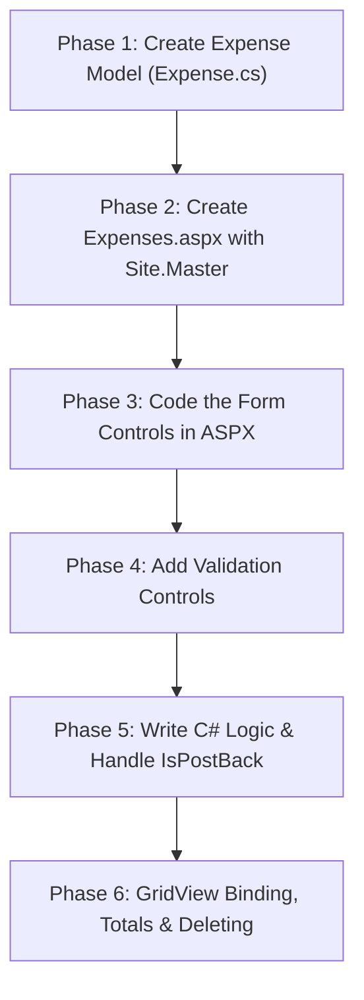

# 📘 Employee Expense Tracker: ASP.NET Web Forms Mini-Project Guide

> **Target Framework:** .NET Framework 4.7.2 (ASP.NET Web Forms)  
> **Language:** C# & ASPX Markup  
> **Styling:** Bootstrap 5 (included in template)  
> **Objective:** Build an end-to-end Expense Tracking Web Application from scratch to master ASP.NET Web Forms fundamentals.

---

## 📑 Table of Contents
1. [Core Web Forms Mental Model](#1-core-web-forms-mental-model)
2. [Project Architecture & File Layout](#2-project-architecture--file-layout)
3. [Features to Build](#3-features-to-build)
4. [Step-by-Step Implementation Roadmap](#4-step-by-step-implementation-roadmap)
   - [Phase 1: The Model Class (`Expense.cs`)](#phase-1-the-model-class-expensecs)
   - [Phase 2: Page Setup & Master Navigation](#phase-2-page-setup--master-navigation)
   - [Phase 3: The ASPX Form UI](#phase-3-the-aspx-form-ui)
   - [Phase 4: Client & Server Validation](#phase-4-client--server-validation)
   - [Phase 5: The C# Logic & State (`Expenses.aspx.cs`)](#phase-5-the-c-logic--state-expensesaspxcs)
   - [Phase 6: GridView, Calculations & Deletions](#phase-6-gridview-calculations--deletions)
5. [Key Concepts Checklist & Interview Questions](#5-key-concepts-checklist--interview-questions)
6. [Roommate Study & Verification Protocol](#6-roommate-study--verification-protocol)

---

## 1. Core Web Forms Mental Model

Unlike modern ASP.NET Core / MVC where you work with HTTP routes and JSON APIs, **ASP.NET Web Forms** is an **event-driven, component-oriented framework**:

```
[ Browser (User) ]
       │
       │ 1. User clicks Button (e.g. "Submit Expense")
       ▼
[ HTTP POST Request (PostBack) ]
       │ Sends: Form input values + Hidden __VIEWSTATE string
       ▼
[ ASP.NET Page Life Cycle on Server ]
       ├─ 1. Page_Init
       ├─ 2. Page_Load (Check if (!IsPostBack) for initial GET)
       ├─ 3. Validation Check (Page.IsValid)
       ├─ 4. Event Handler Fires (btnSubmit_Click runs your C# code)
       └─ 5. Render (Server Controls generate standard HTML)
       ▼
[ HTTP Response (HTML) ] ──▶ Sent back to the Browser
```

### The 4 Golden Rules:
1. **`runat="server"`**: Turns any HTML or ASP tag into a C# object accessible in your code-behind.
2. **`IsPostBack`**: Tells you if the page is being loaded for the first time (HTTP GET) or if it's submitting user data back to itself (HTTP POST).
3. **`ViewState`**: Automatically remembers control states across stateless HTTP requests using a hidden input.
4. **Data Binding**: Connects C# collections (`List<Expense>`) to UI tables (`<asp:GridView>`) with `.DataSource` and `.DataBind()`.

---

## 2. Project Architecture & File Layout

Here is how your project files will look when this project is completed:

```
WebFormPracticeProject/
│
├── Content/                           # CSS Stylesheets
│   ├── Site.css                       # Custom CSS
│   └── bootstrap.min.css              # Bootstrap 5 styling
│
├── Models/
│   └── Expense.cs                     # [PHASE 1] C# Data blueprint
│
├── Expenses.aspx                      # [PHASE 3 & 4] ASPX Markup (HTML + ASP Controls)
├── Expenses.aspx.cs                   # [PHASE 5 & 6] C# Code-Behind (Business Logic)
├── Expenses.aspx.designer.cs          # Auto-generated bridge for server control IDs
│
├── Site.Master                        # [PHASE 2] Master Layout (Navbar & Footer)
└── Web.config                         # Application settings and compilation config
```

---

## 3. Features to Build

### 1. Expense Entry Form
- **Employee Name:** Text input (`<asp:TextBox>`)
- **Expense Category:** Dropdown selection (`<asp:DropDownList>`: Travel, Meals, Software, Office Supplies)
- **Amount:** Numeric decimal input (`<asp:TextBox>`)
- **Expense Date:** Date picker (`<asp:TextBox TextMode="Date">`)
- **Payment Method:** Radio options (`<asp:RadioButtonList>`: Corporate Card, Cash, Personal Card)
- **Receipt Attached:** Checkbox (`<asp:CheckBox>`)
- **Buttons:** Submit (`<asp:Button>`) and Clear (`<asp:Button CausesValidation="false">`)

### 2. Form Validation (Client + Server)
- Name is required.
- Category must be selected (cannot be the default `-- Select --`).
- Amount is required and must be between $1.00 and $50,000.00.
- Date is required.
- All validation messages summarized in an `<asp:ValidationSummary>` block.

### 3. Summary Dashboard
- **Total Expenses Claimed:** Sum of all claim amounts ($).
- **Total Claims Count:** Count of records.
- **Highest Single Claim:** Maximum claim amount ($).

### 4. Interactive Data Grid (`<asp:GridView>`)
- Displays all claims in a responsive Bootstrap table.
- Formats currency properly (`$120.50`).
- Displays a visual badge for receipt status (`Attached` vs `Missing`).
- Search bar to filter by employee name or category.
- Delete button with a JavaScript confirmation dialog.

---

## 4. Step-by-Step Implementation Roadmap



---

### Phase 1: The Model Class (`Expense.cs`)

**Goal:** Define the shape of an expense item in C#.

1. In Visual Studio, right-click the project ➔ **Add** ➔ **New Folder** ➔ name it `Models`.
2. Right-click the `Models` folder ➔ **Add** ➔ **Class** ➔ name it `Expense.cs`.
3. Add the `[Serializable]` attribute (required when storing custom objects in `Session` or `ViewState`).

#### Code Template (`Models/Expense.cs`):
```csharp
using System;

namespace WebFormPracticeProject.Models
{
    [Serializable]
    public class Expense
    {
        public int Id { get; set; }
        public string EmployeeName { get; set; }
        public string Category { get; set; }
        public decimal Amount { get; set; }
        public DateTime ExpenseDate { get; set; }
        public string PaymentMethod { get; set; }
        public bool HasReceipt { get; set; }
    }
}
```

> **Why this matters:** Data needs to be structured cleanly before saving it to in-memory collections, databases, or binding it to web controls.

---

### Phase 2: Page Setup & Master Navigation

**Goal:** Create the `.aspx` page linked to the Master Page and update site navigation.

1. Right-click the project root ➔ **Add** ➔ **New Item...**
2. Choose **Web Form with Master Page** ➔ Name it `Expenses.aspx`.
3. Select `Site.Master` as your master page.
4. Open `Site.Master` and locate the `<ul class="navbar-nav ...">` section.
5. Add a link to your new page:
   ```html
   <li class="nav-item">
       <a class="nav-link" runat="server" href="~/Expenses">Expense Tracker</a>
   </li>
   ```

> **Why this matters:** Master Pages act like layouts. You don't have to copy-paste the navbar, CSS links, or footer into every page.

---

### Phase 3: The ASPX Form UI

**Goal:** Build a responsive 2-column layout using Bootstrap and ASP.NET Server Controls.

Inside `Expenses.aspx`, place your content inside `<asp:Content ID="Content1" ContentPlaceHolderID="MainContent" runat="server">`:

#### Key Controls to Add:
- `<asp:TextBox ID="txtEmployeeName" runat="server" CssClass="form-control" />`
- `<asp:DropDownList ID="ddlCategory" runat="server" CssClass="form-select">`
  - Add items: Travel, Meals, Software, Office Supplies.
- `<asp:TextBox ID="txtAmount" runat="server" CssClass="form-control" TextMode="Number" />`
- `<asp:TextBox ID="txtDate" runat="server" CssClass="form-control" TextMode="Date" />`
- `<asp:RadioButtonList ID="rblPaymentMethod" runat="server" RepeatDirection="Horizontal" CssClass="d-flex gap-3">`
  - Corporate Card, Cash, Personal Card.
- `<asp:CheckBox ID="chkHasReceipt" runat="server" CssClass="form-check-input" />`
- `<asp:Button ID="btnSubmit" runat="server" Text="Submit Expense" CssClass="btn btn-primary" OnClick="btnSubmit_Click" />`
- `<asp:Button ID="btnClear" runat="server" Text="Clear" CssClass="btn btn-secondary" CausesValidation="false" OnClick="btnClear_Click" />`

---

### Phase 4: Client & Server Validation

**Goal:** Prevent invalid submissions without writing custom JavaScript.

Place these validators directly under their respective input controls:

1. **Validation Summary (Top of Form):**
   ```html
   <asp:ValidationSummary ID="valSummary" runat="server" CssClass="alert alert-danger" 
       HeaderText="Please correct the following errors:" />
   ```

2. **Required Field Validator for Employee Name:**
   ```html
   <asp:RequiredFieldValidator ID="rfvName" runat="server" 
       ControlToValidate="txtEmployeeName" 
       ErrorMessage="Employee Name is required." 
       ForeColor="Red" Display="Dynamic" />
   ```

3. **Required Field Validator for Category Dropdown:**
   ```html
   <asp:RequiredFieldValidator ID="rfvCategory" runat="server" 
       ControlToValidate="ddlCategory" 
       InitialValue="" 
       ErrorMessage="Please select an expense category." 
       ForeColor="Red" Display="Dynamic" />
   ```

4. **Range Validator for Amount ($1 to $50,000):**
   ```html
   <asp:RequiredFieldValidator ID="rfvAmount" runat="server" 
       ControlToValidate="txtAmount" 
       ErrorMessage="Amount is required." 
       ForeColor="Red" Display="Dynamic" />

   <asp:RangeValidator ID="rvAmount" runat="server" 
       ControlToValidate="txtAmount" 
       MinimumValue="1" MaximumValue="50000" Type="Double" 
       ErrorMessage="Amount must be between $1 and $50,000." 
       ForeColor="Red" Display="Dynamic" />
   ```

5. **Why `CausesValidation="false"` on the Clear Button?**
   If `CausesValidation` were `true` on the Clear button, clicking "Clear" would trigger red error messages instead of clearing the inputs!

---

### Phase 5: The C# Logic & State (`Expenses.aspx.cs`)

**Goal:** Read form inputs, store data in `Session`, and handle the `IsPostBack` lifecycle.

#### Concept: Session State as our In-Memory Database
```csharp
private const string SessionKey = "App_ExpensesList";

private List<Expense> ExpenseList
{
    get
    {
        if (Session[SessionKey] == null)
        {
            // Starter seed data
            Session[SessionKey] = new List<Expense>
            {
                new Expense { Id = 1, EmployeeName = "Alex Rivera", Category = "Travel", Amount = 450.00m, ExpenseDate = DateTime.Today.AddDays(-3), PaymentMethod = "Corporate Card", HasReceipt = true },
                new Expense { Id = 2, EmployeeName = "Maria Chen", Category = "Software", Amount = 89.99m, ExpenseDate = DateTime.Today.AddDays(-1), PaymentMethod = "Personal Card", HasReceipt = true },
                new Expense { Id = 3, EmployeeName = "John Doe", Category = "Meals", Amount = 35.50m, ExpenseDate = DateTime.Today, PaymentMethod = "Cash", HasReceipt = false }
            };
        }
        return (List<Expense>)Session[SessionKey];
    }
    set { Session[SessionKey] = value; }
}
```

#### The LifeCycle Check (`Page_Load`):
```csharp
protected void Page_Load(object sender, EventArgs e)
{
    // CRITICAL: if (!IsPostBack) runs ONLY on first GET request
    if (!IsPostBack)
    {
        BindExpensesGrid();
    }
}
```

#### Handling the Submit Event:
```csharp
protected void btnSubmit_Click(object sender, EventArgs e)
{
    // 1. Verify server validation
    if (!Page.IsValid) return;

    // 2. Read values from ASP.NET controls
    var list = ExpenseList;
    int nextId = list.Count > 0 ? list.Max(x => x.Id) + 1 : 1;

    var newExpense = new Expense
    {
        Id = nextId,
        EmployeeName = txtEmployeeName.Text.Trim(),
        Category = ddlCategory.SelectedValue,
        Amount = decimal.Parse(txtAmount.Text.Trim()),
        ExpenseDate = DateTime.Parse(txtDate.Text),
        PaymentMethod = rblPaymentMethod.SelectedValue,
        HasReceipt = chkHasReceipt.Checked
    };

    // 3. Save to Session
    list.Add(newExpense);
    ExpenseList = list;

    // 4. Re-bind the table and reset the form
    BindExpensesGrid();
    ClearForm();
}
```

---

### Phase 6: GridView, Calculations & Deletions

**Goal:** Display claims, calculate summary totals, and handle delete events.

#### GridView Markup (`Expenses.aspx`):
```html
<asp:GridView ID="gvExpenses" runat="server" 
    AutoGenerateColumns="False" 
    DataKeyNames="Id" 
    CssClass="table table-hover table-striped align-middle"
    OnRowDeleting="gvExpenses_RowDeleting">
    <Columns>
        <asp:BoundField DataField="Id" HeaderText="#" />
        <asp:BoundField DataField="EmployeeName" HeaderText="Employee" />
        <asp:BoundField DataField="Category" HeaderText="Category" />
        <asp:BoundField DataField="Amount" HeaderText="Amount" DataFormatString="{0:C}" />
        <asp:BoundField DataField="ExpenseDate" HeaderText="Date" DataFormatString="{0:yyyy-MM-dd}" />
        <asp:BoundField DataField="PaymentMethod" HeaderText="Payment" />
        <asp:TemplateField HeaderText="Receipt">
            <ItemTemplate>
                <span class='badge <%# (bool)Eval("HasReceipt") ? "bg-success" : "bg-warning text-dark" %>'>
                    <%# (bool)Eval("HasReceipt") ? "Yes" : "No" %>
                </span>
            </ItemTemplate>
        </asp:TemplateField>
        <asp:TemplateField HeaderText="Actions">
            <ItemTemplate>
                <asp:LinkButton ID="btnDelete" runat="server" 
                    CommandName="Delete" 
                    CssClass="btn btn-sm btn-outline-danger" 
                    CausesValidation="false" 
                    OnClientClick="return confirm('Are you sure you want to delete this expense?');">
                    Delete
                </asp:LinkButton>
            </ItemTemplate>
        </asp:TemplateField>
    </Columns>
</asp:GridView>
```

#### Binding & Summary Calculations (`Expenses.aspx.cs`):
```csharp
private void BindExpensesGrid()
{
    var list = ExpenseList;
    gvExpenses.DataSource = list;
    gvExpenses.DataBind();

    // Calculate Summary Totals using LINQ
    decimal totalSum = list.Count > 0 ? list.Sum(x => x.Amount) : 0;
    decimal maxSingle = list.Count > 0 ? list.Max(x => x.Amount) : 0;

    lblTotalAmount.Text = totalSum.ToString("C");
    lblTotalCount.Text = list.Count.ToString();
    lblMaxExpense.Text = maxSingle.ToString("C");
}

protected void gvExpenses_RowDeleting(object sender, GridViewDeleteEventArgs e)
{
    int expenseId = Convert.ToInt32(gvExpenses.DataKeys[e.RowIndex].Value);

    var list = ExpenseList;
    var toRemove = list.FirstOrDefault(x => x.Id == expenseId);
    if (toRemove != null)
    {
        list.Remove(toRemove);
        ExpenseList = list;
    }

    BindExpensesGrid();
}
```

---

## 5. Key Concepts Checklist & Interview Questions

Test each other on these questions after completing the project:

- [ ] **What is a PostBack?**  
  *Answer:* An HTTP POST request sent from the browser back to the exact same URL/page that generated it.
- [ ] **Why must we write `if (!IsPostBack)` inside `Page_Load`?**  
  *Answer:* To ensure data initialization only occurs on the first visit (GET). If you omit this, initial data reloads every time you click a button, overwriting user changes.
- [ ] **What is ViewState?**  
  *Answer:* An encrypted/encoded hidden field (`__VIEWSTATE`) sent back and forth between client and server so controls can remember their properties and text.
- [ ] **What is the difference between `BoundField` and `TemplateField` in a GridView?**  
  *Answer:* `BoundField` outputs plain text from a property; `TemplateField` lets you customize the HTML markup (badges, custom buttons, formatting) using `<%# Eval("PropertyName") %>`.
- [ ] **Why is `CausesValidation="false"` used on Cancel/Clear/Delete buttons?**  
  *Answer:* To bypass the page's validation checks so user actions like canceling or deleting can proceed without filling out mandatory form inputs.

---

## 6. Roommate Study & Verification Protocol

| Step | Person A | Person B | Sign-off |
| :---: | :--- | :--- | :---: |
| **1** | Codes `Models/Expense.cs` | Explains why `[Serializable]` is used | [ ] |
| **2** | Sets up `Expenses.aspx` & adds nav link in `Site.Master` | Verifies page runs and loads in browser | [ ] |
| **3** | Adds Form Inputs & Validation Controls | Tests submitting empty form & checks error messages | [ ] |
| **4** | Codes `Page_Load` and `btnSubmit_Click` in C# | Explains how `IsPostBack` protects data | [ ] |
| **5** | Implements `GridView` and Delete handling | Tests deleting a row and checks confirmation alert | [ ] |
| **6** | Codes Summary Total calculations with LINQ | Verifies dashboard badges update on add/delete | [ ] |

---

### How to Run:
1. Open the project in **Visual Studio**.
2. Press **`Ctrl + F5`** (Run without debugging) or **`F5`** (Run with debugging).
3. Navigate to **Expense Tracker** in the navbar and start testing!
